# C210 焊笔控制器 — 原理图 / PCB 设计

> 目标板：42 × 24 mm，2 层，1.0 mm FR-4，1 oz 铜，ENIG。
> **本文件中的原理图是 KiCad 10 符号级原理图**（不是方块示意图）；图片直接嵌在下面的 Markdown 中，点击可放大。
> PCB 顶/底图是按网表绘制的布局/装配示意，**不是可直接投产的 Gerber**；投板前必须用 KiCad / 立创 EDA 复核封装与 DRC。

---

## 1. 设计边界

| 项 | 值 |
|---|---|
| MCU | STC8G1K08A-8PIN，SOP8，1T 8051，8KB Flash + 4KB EEPROM |
| 供电 | USB-C 5V/3A sink；CC1/CC2 各 5.1k；F1 3A PTC；SW1 5V/3A |
| 3.3V | AMS1117-3.3；U2 74HCT4053 仍用 +5V |
| 烙铁头 | JBC C210（2 线，加热丝 + K 型热电偶串联） |
| 测温 | MAX31855（SOIC-8，SPI，14 位，0.25°C/LSB） |
| 隔离 | 74HCT4053（SOIC-16），P5.4 高 = 加热 + 传感器断开 |
| 加热 | AOD4184（TO-252），P5.4 栅极，高 = 加热 |
| 显示 | 无；P5.5 LED 状态 |
| 按键 | P3.3，低有效 |
| 保护 | F2 KSD9700 400°C NC；D2 SS34；D3/D4 BAT54S；R4 1k 栅极下拉；R17 SO 下拉；WDT |
| 烧录 | P3.0/P3.1 UART ISP，J3 4-pin |

---

## 2. 系统框图

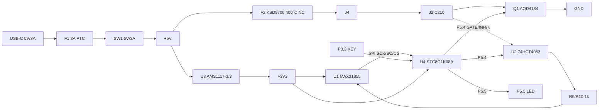

---

## 3. KiCad 原理图（符号级、网表可校验）

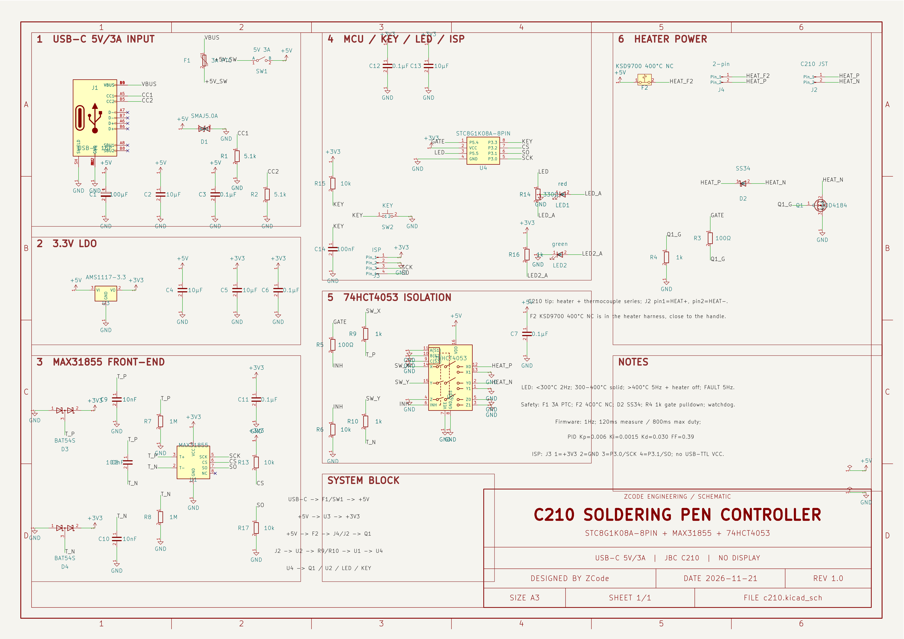

**图片说明**：A3 图幅，KiCad 10 自定义符号库 + 标准符号；块内短连线、块间网络标签；红色细框为功能分区；右下角为自定义 A3 图框/标题栏。
点击图片可放大；更高分辨率/可搜索文本请打开：

- [原理图 PDF](docs/pcb/kicad/c210_schematic.pdf)（矢量，可缩放）
- [原理图 SVG](docs/pcb/kicad/c210_schematic.svg)
- [KiCad 源文件](docs/pcb/kicad/c210.kicad_sch)（KiCad 10 可直接打开/修改）
- [KiCad 网表](docs/pcb/kicad/c210_schematic.net)
- [ERC 报告](docs/pcb/kicad/c210_schematic.erc)（**0 errors / 7 warnings**）

### 3.0 原理图 1/4 放大（同一张图的四个区域）

> 上面是全页图；下面四张是同一张 KiCad 原理图的 1/4 裁切，文字更大，便于在 MD 中直接阅读。四张拼起来就是完整 A3 原理图。

| 左上：USB-C 输入 / 3.3V LDO | 右上：MCU / 按键 / LED / ISP |
|---|---|
| 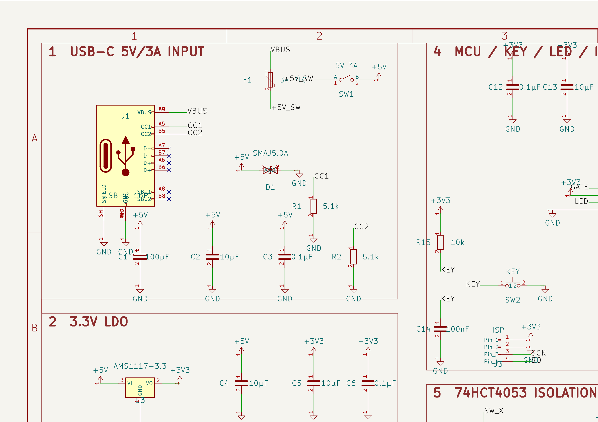 | 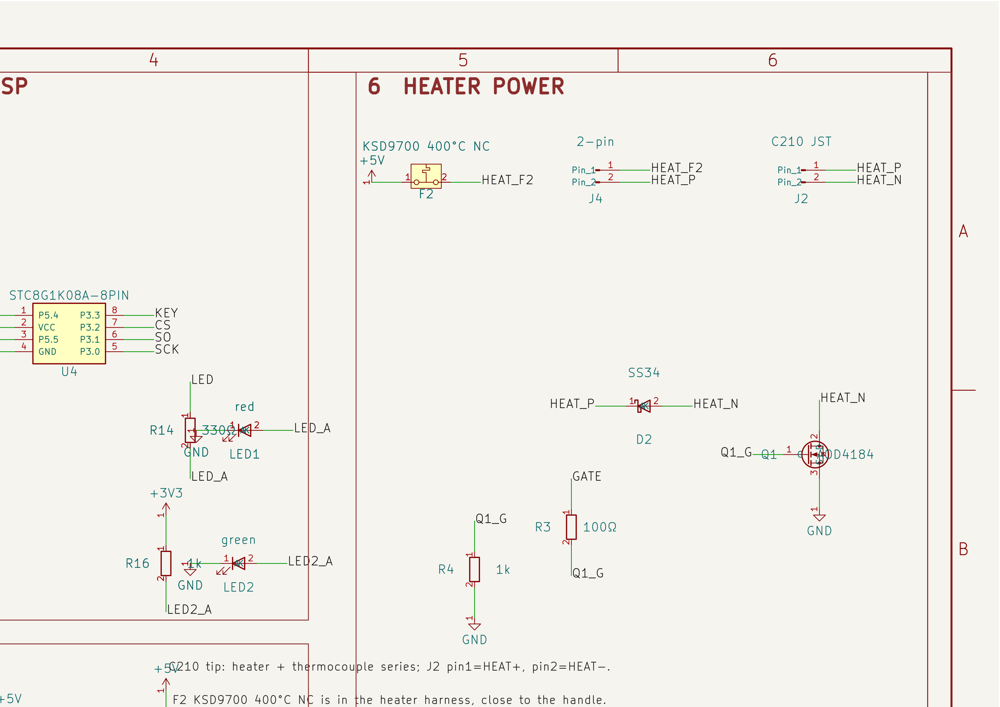 |

| 左下：MAX31855 前端 / 4053 | 右下：加热级 / 注释 / 标题栏 |
|---|---|
| 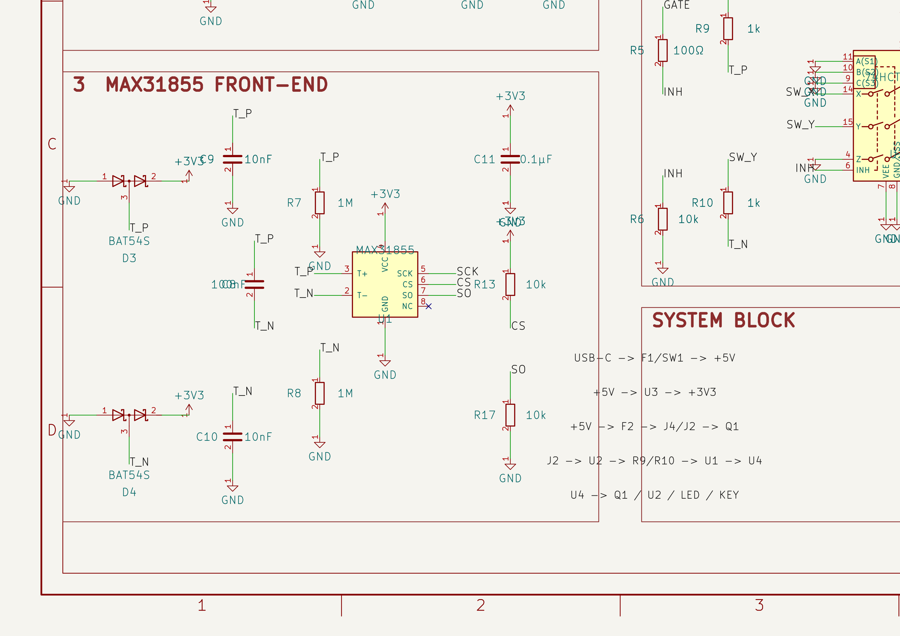 | 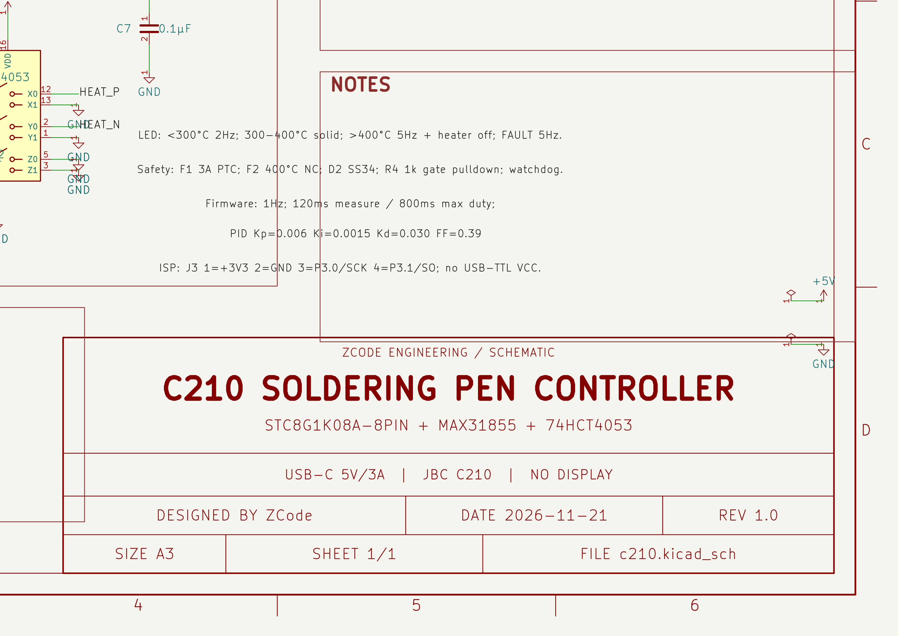 |

### 3.1 ERC 结论

```text
ERC messages: 0 errors / 7 warnings
```

7 条 warning 分两类：

- **5 条 `pin_to_pin`**：U2 74HCT4053 的未用通道/选择脚（`C0/C1/C`、`A1/B1`）接到 GND，而 GND 上有 PWR_FLAG（Power output）。这是**有意为之**：
- 4053 的 X1/Y1 必须接 GND；
- Z 通道未用，C0/C1/C 接 GND 防止浮空；
- A/B/C 选择脚接 GND（选 X0/Y0/Z0）；
- 这些 bidirectional 引脚接 GND 会触发 ERC 的 `pin_to_pin` 提示，不是错连。
- **2 条 `lib_symbol_mismatch`**：`MAX31855` / `STC8G1K08A-8PIN` 的嵌入符号与 `c210.kicad_sym` 名称比较提示；引脚/图形一致，不是电气问题。打开工程后可在 ERC 里把这两条排除，或忽略。

### 3.2 关键连接（与网表一致）

| 功能 | 连接 |
|---|---|
| USB-C | VBUS → F1 → `+5V_SW` → SW1 → `+5V`；CC1/CC2 → R1/R2 5.1k → GND；D+/D-/SBU1/SBU2 悬空（NC） |
| LDO | U3 VI=`+5V`，VO=`+3V3`，GND；C4/C5 10µF，C6/C7 0.1µF |
| 加热 | `+5V` → F2（KSD9700 400°C NC）→ J4 pin1；J4 pin2=`HEAT_P`；J2 pin1=`HEAT_P`，pin2=`HEAT_N`；Q1 D=`HEAT_N`，S=GND，G=`Q1_G`；R3 100Ω `GATE`→`Q1_G`；R4 1k `Q1_G`→GND；D2 SS34 K=`HEAT_P`、A=`HEAT_N` |
| 4053 | X0(pin12)=`HEAT_P`，Y0(pin2)=`HEAT_N`；X(pin14)=`SW_X`→R9 1k→`T_P`；Y(pin15)=`SW_Y`→R10 1k→`T_N`；X1(pin13)=Y1(pin1)=GND；Z0/Z1/Z(pin5/3/4)=GND；INH(pin6)=`INH`；VDD(pin16)=`+5V`；VEE(pin7)=VSS(pin8)=GND；S1/S2/S3(pin11/10/9)=GND |
| MAX31855 | T+(pin3)=`T_P`，T-(pin2)=`T_N`；VCC(pin4)=`+3V3`；GND(pin1)=GND；SCK(pin5)=`SCK`；CS(pin6)=`CS`；SO(pin7)=`SO`；NC(pin8) 悬空 |
| 传感器前端 | R7/R8 1M 到 GND；C8 100nF 差分；C9/C10 10nF 共模；D3/D4 BAT54S：**pin1=GND、pin2=`+3V3`、pin3=`T_P`/`T_N`**（按 BAT54S 实际 SOT-23 引脚）；C11 0.1µF；R13 10k `CS`→`+3V3`；R17 10k `SO`→GND |
| MCU | P3.0=`SCK`，P3.1=`SO`，P3.2=`CS`，P3.3=`KEY`，P5.4=`GATE`，P5.5=`LED`；VCC=`+3V3`，GND；C12 0.1µF、C13 10µF |
| 按键/LED/ISP | SW2 `KEY`→GND；R15 10k `KEY`→`+3V3`；C14 100nF `KEY`→GND；R14 330Ω `LED`→`LED_A`→LED1→GND；J3 1=`+3V3` 2=GND 3=`SCK` 4=`SO`；R16 1k `+3V3`→LED2→GND |

---

## 4. 完整网表（KiCad `c210_schematic.net`）

> 这是 `kicad-cli sch export netlist` 的真实输出，不是手抄。U4 使用自定义 SOP8 符号（8 pin，无 EPAD）；J1 的 D+/D-/SBU1/SBU2、U1.8 NC 为 no-connect。

| Net | Nodes |
|---|---|
| `+3V3` | C11.1, C12.1, C13.1, C5.1, C6.1, D3.2, D4.2, J3.1, R13.1, R15.1, R16.1, U1.4, U3.2, U4.2 |
| `+5V` | C1.1, C2.1, C3.1, C4.1, C7.1, D1.1, F2.1, SW1.2, U2.16, U3.3 |
| `/+5V_SW` | F1.2, SW1.1 |
| `/CC1` | J1.A5, R1.1 |
| `/CC2` | J1.B5, R2.1 |
| `/CS` | R13.2, U1.6, U4.7 |
| `/GATE` | R3.1, R5.1, U4.1 |
| `/HEAT_F2` | F2.2, J4.1 |
| `/HEAT_N` | D2.2, J2.2, Q1.2, U2.2 |
| `/HEAT_P` | D2.1, J2.1, J4.2, U2.12 |
| `/INH` | R5.2, R6.1, U2.6 |
| `/KEY` | C14.1, R15.2, SW2.1, U4.8 |
| `/LED` | R14.1, U4.3 |
| `/LED2_A` | LED2.2, R16.2 |
| `/LED_A` | LED1.2, R14.2 |
| `/Q1_G` | Q1.1, R3.2, R4.1 |
| `/SCK` | J3.3, U1.5, U4.5 |
| `/SO` | J3.4, R17.1, U1.7, U4.6 |
| `/SW_X` | R9.1, U2.14 |
| `/SW_Y` | R10.1, U2.15 |
| `/T_N` | C10.1, C8.2, D4.3, R10.2, R8.1, U1.2 |
| `/T_P` | C8.1, C9.1, D3.3, R7.1, R9.2, U1.3 |
| `/VBUS` | F1.1, J1.A4, J1.A9, J1.B4, J1.B9 |
| `GND` | C1.2, C10.2, C11.2, C12.2, C13.2, C14.2, C2.2, C3.2, C4.2, C5.2, C6.2, C7.2, C9.2, D1.2, D3.1, D4.1, J1.A1, J1.A12, J1.B1, J1.B12, J1.SH, J3.2, LED1.1, LED2.1, Q1.3, R1.2, R17.2, R2.2, R4.2, R6.2, R7.2, R8.2, SW2.2, U1.1, U2.1, U2.10, U2.11, U2.13, U2.3, U2.4, U2.5, U2.7, U2.8, U2.9, U3.1, U4.4 |
| `unconnected-(J1-D+-PadA6)` | J1.A6 |
| `unconnected-(J1-D+-PadB6)` | J1.B6 |
| `unconnected-(J1-D--PadA7)` | J1.A7 |
| `unconnected-(J1-D--PadB7)` | J1.B7 |
| `unconnected-(J1-SBU1-PadA8)` | J1.A8 |
| `unconnected-(J1-SBU2-PadB8)` | J1.B8 |
| `unconnected-(U1-NC-Pad8)` | U1.8 |

### 4.1 网表自检结论

- U1 `T+`/`T-`/`SCK`/`CS`/`SO` 全部在对应网络；
- U2 `A0=HEAT_P`、`B0=HEAT_N`、`A→R9→T_P`、`B→R10→T_N`、`INH`、`VDD=+5V`、`VEE/VSS=GND` 全部正确；
- Q1 `G/D/S`、D2 `K/A`、D3/D4 BAT54S 三脚方向正确；
- J1 的 4 个 VBUS 堆叠脚全部在 `/VBUS`；4 个 GND + SHIELD 全部在 `GND`；
- R1/R2 5.1k 在 CC1/CC2；R13 10k CS 上拉；R17 10k SO 下拉；C7 0.1µF 在 +5V/GND；
- 只有 USB-C 的 D+/D-/SBU1/SBU2、U1 NC、U4 EPAD 为 no-connect，符合设计。

---

## 5. 引脚表

### 5.1 STC8G1K08A-8PIN（SOP8）

| Pin | 名称 | 用途 |
|---|---|---|
| 1 | P5.4 | Q1 栅极 / 4053 INH |
| 2 | VCC | +3V3 |
| 3 | P5.5 | 状态 LED |
| 4 | GND | GND |
| 5 | P3.0 | MAX31855 SCK / ISP RX |
| 6 | P3.1 | MAX31855 SO / ISP TX |
| 7 | P3.2 | MAX31855 CS |
| 8 | P3.3 | 按键 KEY |

### 5.2 MAX31855（SOIC-8）

| Pin | 名称 | 连接 |
|---|---|---|
| 1 | GND | GND |
| 2 | T- | `T_N` |
| 3 | T+ | `T_P` |
| 4 | VCC | +3V3 |
| 5 | SCK | `SCK` |
| 6 | CS | `CS` |
| 7 | SO | `SO` |
| 8 | NC | 悬空 |

### 5.3 74HCT4053（SOIC-16）

| Pin | 名称 | 连接 |
|---|---|---|
| 1 | Y1 | GND |
| 2 | Y0 | `HEAT_N` |
| 3 | Z1 | GND |
| 4 | Z | GND |
| 5 | Z0 | GND |
| 6 | INH | `INH` |
| 7 | VEE | GND |
| 8 | GND/VSS | GND |
| 9 | C（S3） | GND |
| 10 | B（S2） | GND |
| 11 | A（S1） | GND |
| 12 | X0 | `HEAT_P` |
| 13 | X1 | GND |
| 14 | X | `SW_X` → R9 1k → `T_P` |
| 15 | Y | `SW_Y` → R10 1k → `T_N` |
| 16 | VDD | +5V |

> 4053 的 A/B/C 选择脚接 GND，选 X0/Y0/Z0；INH 高 = 全部开关断开（加热时隔离传感器）。

---

## 6. BOM

| Ref | Value | Package | Qty | 备注 |
|---|---|---|---:|---|
| J1 | USB-C 16P 母座 | SMD | 1 | 5V/3A sink，CC1/CC2 各 5.1k |
| F1 | PTC 3A hold / 6A trip | 1812 | 1 | 自恢复保险 |
| SW1 | 5V 3A 滑动开关 | THT | 1 | 总电源 |
| D1 | SMAJ5.0A | SMA | 1 | TVS |
| C1 | 100µF/10V | SMD 电解 6.3×6.3 | 1 | 5V 储能 |
| C2 | 10µF/10V | 0805 | 1 | |
| C3 | 0.1µF | 0603 | 1 | |
| U3 | AMS1117-3.3 | SOT-223 | 1 | 3.3V LDO |
| C4 | 10µF/10V | 0805 | 1 | LDO 输入 |
| C5 | 10µF/10V | 0805 | 1 | LDO 输出 |
| C6 | 0.1µF | 0603 | 1 | |
| U2 | 74HCT4053 | SOIC-16 | 1 | +5V 供电 |
| C7 | 0.1µF | 0603 | 1 | U2 去耦（底面） |
| R5 | 100Ω | 0603 | 1 | INH 串联 |
| R6 | 10kΩ | 0603 | 1 | INH 下拉 |
| J2 | 2-pin JST XH 2.5mm | THT | 1 | C210 头 |
| J4 | 2-pin 2.54 | THT | 1 | KSD9700 线束 |
| F2 | KSD9700 400°C NC | 线束 | 1 | 串在加热回路，靠近手柄 |
| Q1 | AOD4184 | TO-252 | 1 | N-MOSFET，2A |
| R3 | 100Ω | 0603 | 1 | 栅极串联 |
| R4 | **1kΩ** | 0603 | 1 | 栅极下拉（抗 P5.4 上电 4K 上拉） |
| D2 | SS34 | SMA | 1 | 续流，K=HEAT_P / A=HEAT_N |
| U1 | MAX31855 | SOIC-8 | 1 | K 型热电偶 |
| C11 | 0.1µF | 0603 | 1 | U1 去耦 |
| R13 | 10kΩ | 0603 | 1 | CS 上拉 |
| R17 | **10kΩ** | 0603 | 1 | SO 下拉（芯片缺失时读数确定） |
| R7/R8 | 1MΩ | 0603 | 2 | T+/T- 偏置 |
| R9/R10 | **1kΩ** | 0603 | 2 | T+/T- 串联限流（原 100Ω） |
| D3/D4 | **BAT54S** | SOT-23 | 2 | pin1=GND、pin2=+3V3、pin3=T_P/T_N |
| C8 | 100nF | 0603 | 1 | 差分滤波 |
| C9/C10 | 10nF | 0603 | 2 | 共模滤波 |
| U4 | STC8G1K08A-8PIN | SOP8 | 1 | MCU |
| C12 | 0.1µF | 0603 | 1 | MCU 去耦 |
| C13 | 10µF | 0805 | 1 | MCU 去耦 |
| LED1 | 红色 0805 | 0805 | 1 | 状态 |
| R14 | 330Ω | 0603 | 1 | LED 限流 |
| SW2 | 6×6 轻触开关 | THT | 1 | KEY |
| R15 | 10kΩ | 0603 | 1 | KEY 上拉 |
| C14 | 100nF | 0603 | 1 | KEY 消抖 |
| J3 | 4-pin 2.54 | THT | 1 | ISP：+3V3/GND/P3.0/P3.1 |
| LED2 | 绿色 3mm | THT | 1 | 电源指示 |
| R16 | 1kΩ | 0603 | 1 | LED2 限流 |
| R1/R2 | **5.1kΩ** | 0603 | 2 | USB-C CC1/CC2 下拉（底面） |
| TP1–TP6 | 测试点 | 1.5mm pad | 6 | +5V/+3V3/GND/GATE/T+/T- |
| MH1–MH4 | M2 安装孔 | Ø2.2mm | 4 | 按外壳调整 |

> **新增/变更相对原始规格**：R4 10k→1k；R9/R10 100Ω→1k；新增 D3/D4 BAT54S；新增 R17 10k SO 下拉；C7/R1/R2 必须在 BOM 和 PCB 中（原始规格有，早期渲染漏了，已补）。

---

## 7. 叠层

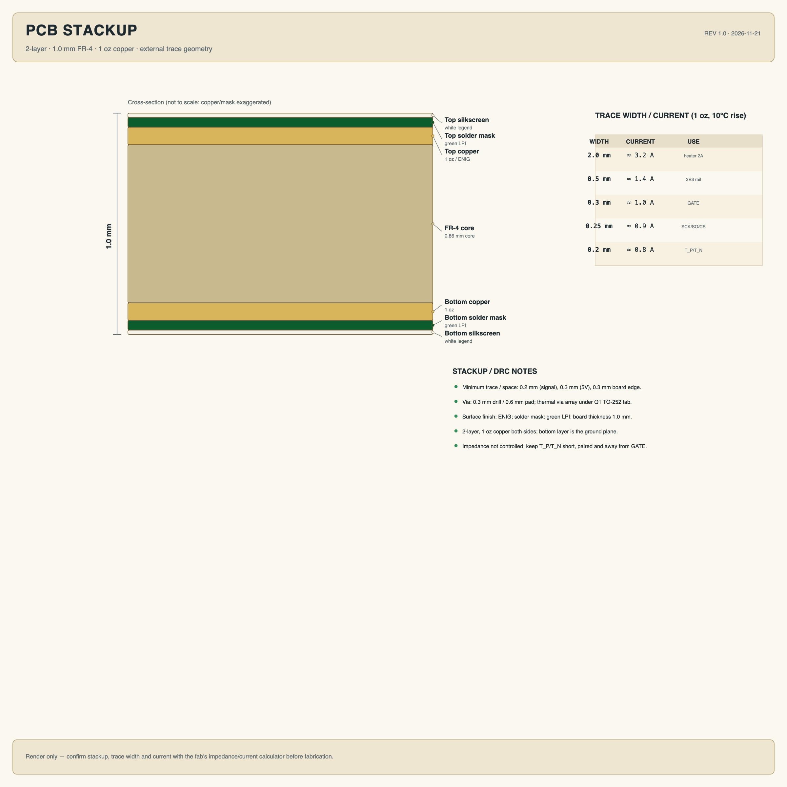

| 层 | 材料 | 厚度 | 说明 |
|---|---|---:|---|
| Top silkscreen | 白色字符 | 10 µm | 位号/极性/网络名 |
| Top solder mask | 绿色 LPI | 20 µm | 阻焊 |
| Top copper | 1 oz 铜 | 35 µm | 信号 + 5V/2A + 3.3V |
| FR-4 core | FR-4 | 0.86 mm | Tg 130–150 |
| Bottom copper | 1 oz 铜 | 35 µm | GND 平面 + 底面走线 |
| Bottom solder mask | 绿色 LPI | 20 µm | |
| Bottom silkscreen | 白色字符 | 10 µm | |
| **总厚** | | **1.0 mm** | 按外壳要求可选 0.8 mm |

- 2 层、1 oz、ENIG；最小线宽/间距 0.2 mm；过孔 0.3/0.6 mm；板边 0.3 mm。
- 载流（1 oz，10°C 温升，IPC-2221 近似）：2.0 mm ≈ 3.2 A；0.5 mm ≈ 1.4 A；0.3 mm ≈ 1.0 A；0.25 mm ≈ 0.9 A；0.2 mm ≈ 0.8 A。
- 5V/2A 路径只用 2.0 mm + 铺铜，不用 0.5 mm 细线。

---

## 8. PCB 顶视图

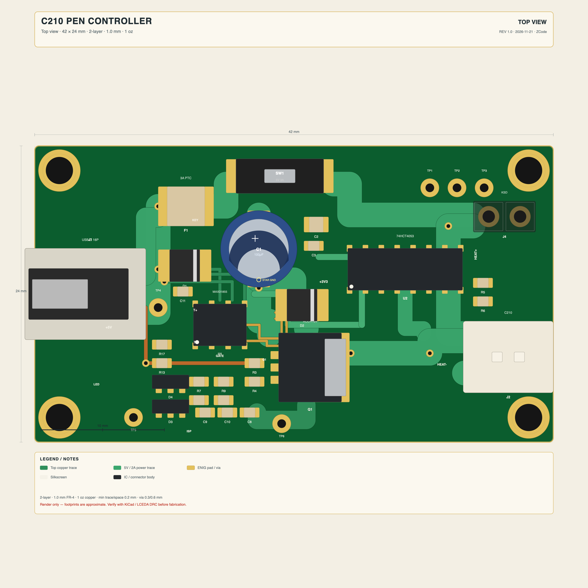

- 板框 42×24 mm，圆角，4× M2 安装孔。
- J1 USB-C 在左边缘；J2/J4 在右边缘；SW1 在上边缘；J3/SW2 在底面。
- 顶面主要器件：J1、F1、SW1、D1、C1–C3、U2、U1、Q1、D2、R3/R4、R5/R6、R7–R10、R13、R17、D3/D4、C8–C11、J2、J4、TP1–TP6。
- 5V/2A 走线 2.0 mm（VBUS→F1→SW1→J4/J2/Q1）；3.3V 0.5 mm；GATE 0.3 mm；T_P/T_N 0.2 mm 成对；SCK/SO/CS 0.25 mm。
- Q1 TO-252 的 tab 下方有散热过孔阵列；底面 GND 铺铜。
- `STAR GND` 黄圈在 C1 负极；模拟地岛与功率地在 C1 负极单点连接。

---

## 9. PCB 底视图（镜像）

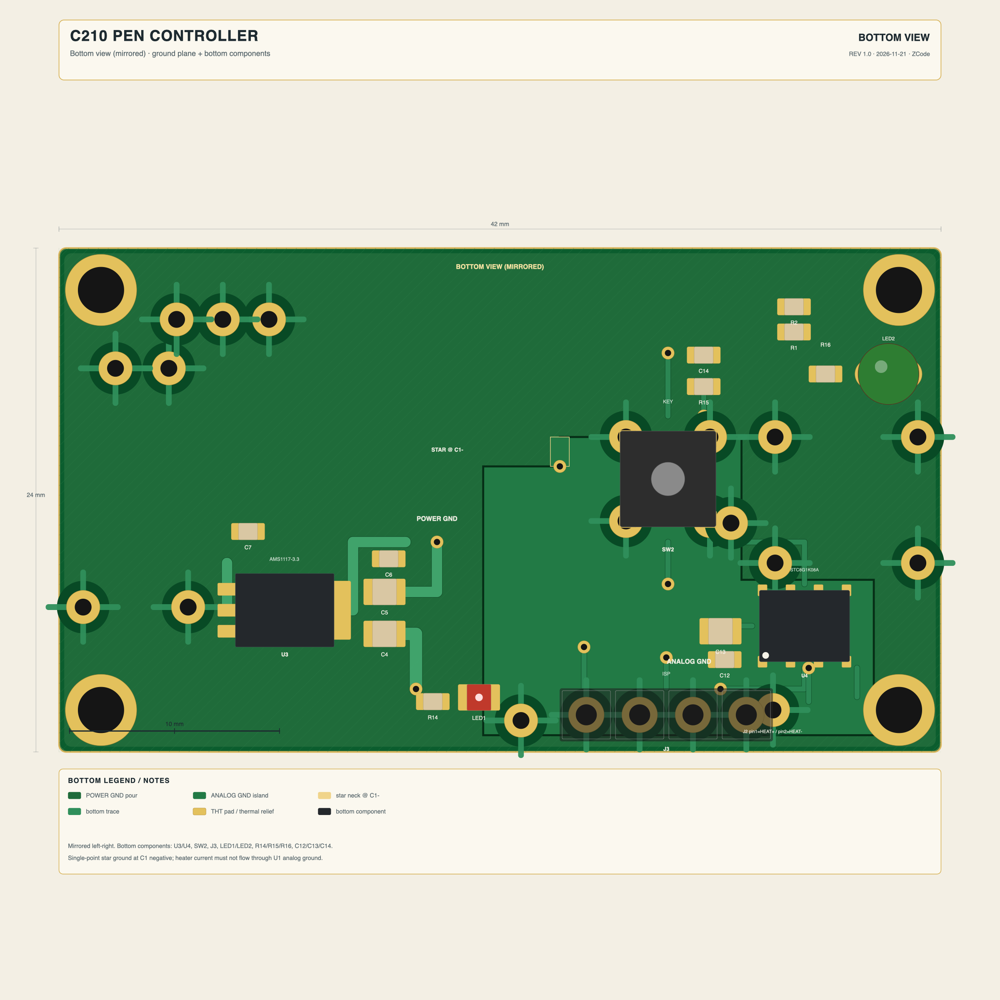

- 底面：GND 铺铜（POWER GND / ANALOG GND 分区，单点星形连接）。
- 底面器件：U3 AMS1117-3.3、U4 STC8G1K08A、SW2、J3 ISP、LED1/LED2、R1/R2、R14/R15/R16、C7、C12/C13/C14。
- 所有 THT 焊盘有热焊盘/热隔离；J1 shield、J2/J4、J3、SW2、安装孔都有热焊盘。
- 底面标注 `BOTTOM VIEW (MIRRORED)`；文字正向，便于阅读。
- 加热电流只走功率地；U1 模拟地不流加热电流。

---

## 10. 装配轴测图

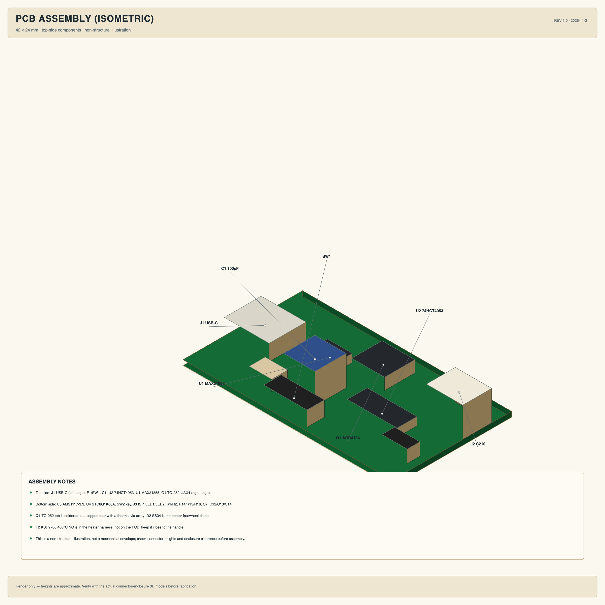

- 非结构件、非机械包络；只用于看器件高度/方向/连接器朝向。
- 顶面：USB-C 在左，J2/J4 在右，SW1 在上；Q1 TO-252 的 tab 是大面积焊盘。
- 底面：U3/U4/SW2/J3/LED1/LED2/R1/R2/R14-R16/C7/C12-C14（在底视图/装配说明中列出，轴测图只画顶面主要器件）。
- 具体高度/外壳间隙必须用实际连接器和外壳 3D 模型复核。

---

## 11. 布局规则

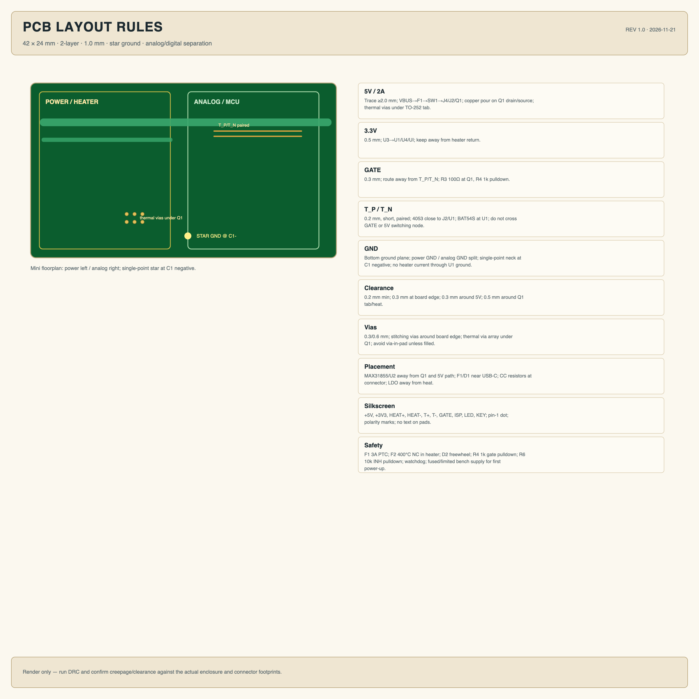

| 规则 | 要求 |
|---|---|
| 5V/2A | 走线 ≥2.0 mm；VBUS→F1→SW1→J4/J2/Q1；Q1 drain/source 铺铜 + TO-252 tab 散热过孔 |
| 3.3V | 0.5 mm；U3→U1/U4/UI；远离加热回流 |
| GATE | 0.3 mm；远离 T_P/T_N；R3 100Ω 靠近 Q1，R4 1k 下拉 |
| T_P/T_N | 0.2 mm，短、成对；4053 靠近 J2/U1；BAT54S 紧靠 U1；不跨 GATE/5V 开关节点 |
| GND | 底面铺铜；POWER GND / ANALOG GND 分区；C1 负极单点连接；加热电流不进 U1 地 |
| 间距 | 最小 0.2 mm；5V 0.3 mm；Q1 tab 周围 0.5 mm；板边 0.3 mm |
| 过孔 | 0.3/0.6 mm；板边缝合孔；Q1 散热过孔阵列；避免未填充的 via-in-pad |
| 放置 | MAX31855/U2 远离 Q1/5V 大电流；F1/D1 靠近 USB-C；CC 电阻靠近连接器；LDO 远离热源 |
| 丝印 | +5V/+3V3/HEAT+/HEAT-/T+/T-/GATE/ISP/LED/KEY；pin1 点；极性；不压焊盘 |
| 安全 | F1 3A PTC；F2 400°C NC；D2 续流；R4 1k；R6 10k；WDT；首次限流上电 |

---

## 12. Placement 表

> 坐标原点 = 板左下角，单位 mm，y 向上；底面坐标是同一板坐标系（底视图渲染时镜像）。
> 这些坐标与 `docs/pcb/gen_pcb.py` 的 `TOP`/`BOTTOM` 数据一致。

### 12.1 顶面

| Ref | Value | Package | Side | X mm | Y mm | Rot |
|---|---|---|---|---:|---:|---:|
| J1 | USB-C 16P | USB-C 16P SMD | top | 4.50 | 12.00 | 0 |
| F1 | 3A PTC | 1812 | top | 12.25 | 19.10 | 0 |
| SW1 | 5V 3A | THT slide | top | 19.85 | 21.55 | 0 |
| D1 | SMAJ5.0A | SMA | top | 12.15 | 14.30 | 0 |
| C1 | 100µF | SMD elec 6.3 | top | 18.15 | 15.65 | 0 |
| C2 | 10µF | 0805 | top | 22.80 | 17.62 | 0 |
| C3 | 0.1µF | 0603 | top | 22.60 | 15.90 | 0 |
| U2 | 74HCT4053 | SOIC-16 | top | 30.00 | 14.00 | 0 |
| U1 | MAX31855 | SOIC-8 | top | 15.00 | 9.50 | 0 |
| C11 | 0.1µF | 0603 | top | 12.00 | 12.20 | 0 |
| R7 | 1M | 0603 | top | 13.30 | 4.90 | 0 |
| R8 | 1M | 0603 | top | 13.30 | 3.40 | 0 |
| R9 | 1k | 0603 | top | 15.30 | 4.90 | 0 |
| R10 | 1k | 0603 | top | 15.30 | 3.40 | 0 |
| D3 | BAT54S | SOT-23 | top | 11.00 | 2.75 | 0 |
| D4 | BAT54S | SOT-23 | top | 11.00 | 4.75 | 0 |
| C8 | 100nF | 0603 | top | 17.40 | 2.40 | 0 |
| C9 | 10nF | 0603 | top | 13.80 | 2.40 | 0 |
| C10 | 10nF | 0603 | top | 15.60 | 2.40 | 0 |
| R13 | 10k | 0603 | top | 10.30 | 6.40 | 0 |
| R17 | 10k | 0603 | top | 10.30 | 7.90 | 0 |
| R5 | 100Ω | 0603 | top | 36.30 | 12.90 | 0 |
| R6 | 10k | 0603 | top | 36.30 | 11.40 | 0 |
| Q1 | AOD4184 | TO-252 | top | 22.30 | 6.05 | 0 |
| D2 | SS34 | SMA | top | 21.65 | 11.10 | 0 |
| R3 | 100Ω | 0603 | top | 17.80 | 6.40 | 0 |
| R4 | 1k | 0603 | top | 17.80 | 4.90 | 0 |
| J2 | C210 | JST XH 2p | top | 38.35 | 6.90 | 0 |
| J4 | KSD | 2.54 2p | top | 38.04 | 18.27 | 0 |
| TP1 | +5V | 1.5mm pad | top | 32.00 | 20.60 | 0 |
| TP2 | +3V3 | 1.5mm pad | top | 34.20 | 20.60 | 0 |
| TP3 | GND | 1.5mm pad | top | 36.40 | 20.60 | 0 |
| TP4 | GATE | 1.5mm pad | top | 10.00 | 10.90 | 0 |
| TP5 | T+ | 1.5mm pad | top | 8.00 | 2.00 | 0 |
| TP6 | T- | 1.5mm pad | top | 20.00 | 1.50 | 0 |

### 12.2 底面

| Ref | Value | Package | Side | X mm | Y mm | Rot |
|---|---|---|---|---:|---:|---:|
| U3 | AMS1117-3.3 | SOT-223 | bottom | 31.25 | 6.75 | 0 |
| C4 | 10µF | 0805 | bottom | 26.50 | 5.62 | 0 |
| C5 | 10µF | 0805 | bottom | 26.50 | 7.62 | 0 |
| C6 | 0.1µF | 0603 | bottom | 26.30 | 9.20 | 0 |
| C7 | 0.1µF | 0603 | bottom | 33.00 | 10.50 | 0 |
| U4 | STC8G1K08A | SOIC-8 | bottom | 6.50 | 6.00 | 0 |
| C12 | 0.1µF | 0603 | bottom | 10.30 | 4.40 | 0 |
| C13 | 10µF | 0805 | bottom | 10.50 | 5.75 | 0 |
| LED1 | 红色 | 0805 | bottom | 22.00 | 2.60 | 0 |
| R14 | 330Ω | 0603 | bottom | 24.20 | 2.40 | 0 |
| SW2 | KEY | 6×6 THT | bottom | 13.00 | 13.00 | 0 |
| R15 | 10k | 0603 | bottom | 11.30 | 17.40 | 0 |
| C14 | 100nF | 0603 | bottom | 11.30 | 18.90 | 0 |
| J3 | ISP | 2.54 4p | bottom | 13.08 | 1.77 | 0 |
| LED2 | 绿色 | 3mm THT | bottom | 2.50 | 18.00 | 0 |
| R16 | 1k | 0603 | bottom | 5.50 | 18.00 | 0 |
| R1 | 5.1k | 0603 | bottom | 7.00 | 20.00 | 0 |
| R2 | 5.1k | 0603 | bottom | 7.00 | 21.20 | 0 |

---

## 13. 走线 / 过孔 / 测试点 / 安装孔

### 13.1 关键走线

| Net | Width | Layer | 说明 |
|---|---:|---|---|
| VBUS / +5V_SW / +5V | 2.0 mm | top | USB-C→F1→SW1→C1/J4/Q1；铺铜 |
| HEAT_P / HEAT_N | 2.0 mm | top | J4/J2→Q1/D2；短、粗 |
| +3V3 | 0.5 mm | top/bottom | U3→U1/U4/UI |
| GATE | 0.3 mm | top | P5.4→R3→Q1；远离 T_P/T_N |
| T_P / T_N | 0.2 mm | top | U2 X/Y→R9/R10→U1；成对、短 |
| SCK/SO/CS | 0.25 mm | top | U1→U4/J3 |
| KEY/LED | 0.25 mm | top/bottom | P3.3/P5.5→SW2/LED1 |

### 13.2 过孔

| 类型 | 尺寸 | 用途 |
|---|---|---|
| 信号/缝合 | 0.3 mm drill / 0.6 mm pad | 顶层/底层互连、板边 GND 缝合 |
| Q1 散热 | 0.3/0.6 mm 阵列 | TO-252 tab 到 5V/GND 铺铜（按实际网络） |
| 星形地 | 0.3/0.6 mm | C1 负极单点连接 |

### 13.3 测试点

| TP | 网络 | 位置 |
|---|---|---|
| TP1 | +5V | 顶面 |
| TP2 | +3V3 | 顶面 |
| TP3 | GND | 顶面 |
| TP4 | GATE | 顶面 |
| TP5 | T+ | 顶面 |
| TP6 | T- | 顶面 |

### 13.4 安装孔

| MH | 位置 | 尺寸 |
|---|---|---|
| MH1 | (2, 2) mm | Ø2.2 mm，M2 |
| MH2 | (40, 2) mm | Ø2.2 mm，M2 |
| MH3 | (2, 22) mm | Ø2.2 mm，M2 |
| MH4 | (40, 22) mm | Ø2.2 mm，M2 |

---

## 14. 电源 / 热 / 信号完整性

- **5V/2A**：USB-C VBUS→F1→SW1→J4/J2/Q1 用 2.0 mm 走线 + 铺铜；C1 100µF 靠近 Q1/J2；D1 TVS 靠近 USB-C。
- **Q1 热**：AOD4184 TO-252 在 2A、3.0V Vgs 下 Rds(on) 约 10–15mΩ，功耗约 40–60mW；TO-252 tab 铺铜 + 散热过孔，实际温升远低于 20°C。
- **LDO**：AMS1117 5→3.3V，3.3V 负载约 20–30mA，功耗约 50mW；SOT-223 温升可接受；C4/C5 10µF。
- **模拟**：MAX31855 远离 Q1、5V 大电流、J2；T_P/T_N 成对短走线，BAT54S 紧靠 U1；1M 偏置 + 100nF/10nF 滤波；U2 靠近 J2/U1。
- **地**：底面 GND 平面；功率地/模拟地分区；C1 负极单点星形连接；加热电流不流 U1 地。
- **EMC**：1Hz 加热脉冲，C1 100µF + C2/C3 去耦；D1 TVS；GATE 串 100Ω；T_P/T_N 不跨 GATE；必要时加地包围/开槽。

---

## 15. 安全 / 保护

| 保护 | 作用 |
|---|---|
| F1 3A PTC | USB-C 输入过流/短路 |
| D1 SMAJ5.0A | 5V TVS |
| F2 KSD9700 400°C NC | 加热回路硬件超温断开（靠近手柄） |
| D2 SS34 | 加热丝续流 |
| R4 1k 栅极下拉 | P5.4 复位/上电 6.5ms 内部 4K 上拉时保证 Q1 关断 |
| R6 10k INH 下拉 | P5.4 高阻时 4053 闭合/加热关断 |
| R17 10k SO 下拉 | MAX31855 缺失时 SO 确定低，裸板自检可预测 |
| R9/R10 1k + D3/D4 BAT54S | 5V 共模钳位，保护 MAX31855 输入 |
| 看门狗 | `WDT_CONTR=0x35`，约 1.05s；主循环喂狗 |
| 固件 | 传感器故障、T>420°C、跳变、10 周期不升温 → FAULT；T>400°C 关加热 |
| 首件 | 限流电源、有人值守、先 3.3V/5V 后加热 |

> **注意**：F2 是线束件，不在 PCB 上；必须串在 +5V 与 J4 pin1 之间，靠近手柄。J2/J4 的线材用双绞线，尽量短。

---

## 16. 制造 / 装配

- 2 层、1.0 mm、1 oz、ENIG、绿色 LPI；最小线宽/间距 0.2 mm；过孔 0.3/0.6 mm。
- 板框 42×24 mm，4× M2 安装孔；按外壳可改 38×22 mm，但需重新 DRC。
- 顶面：USB-C 在左、J2/J4 在右、SW1 在上；J1 连接器可适当伸出板边。
- 底面：U3/U4/SW2/J3/LED1/LED2/R1/R2/C7/C12-C14；注意底面器件与外壳/手的间隙。
- 回流焊：先底面小件/大件，再顶面；USB-C/开关/排针最后手工焊；Q1 tab 需要足够焊膏/热焊盘。
- 清洗助焊剂；检查 Q1 tab 空洞、USB-C 壳脚、J2/J4 焊点。
- **本渲染不是 Gerber**：封装尺寸为近似值；投板前用 KiCad/立创 EDA 重新建封装并跑 DRC。

---

## 17. 上电调试步骤

1. **不通电**：目视/万用表查 +5V–GND、+3V3–GND 不短路；Q1 G–S 约 1k（R4）；HEAT_P–HEAT_N 经 C210 头约 2Ω；F2 通断。
2. **限流 5V/300mA，不接烙铁头**：上电测 +5V/+3V3；P5.5 应待机慢闪；按 P3.3 → 约 10s 后 FAULT 快闪（无传感器/无升温），证明固件在跑。
3. **接 MAX31855 + K 热电偶，不接加热**：室温读数合理；用手捏/热水/冰水检查变化；LED <300°C 2Hz、300–400°C 常亮、>400°C 快闪（用加热台/热风模拟，注意传感器上限）。
4. **接 PCB + C210 头，限流 5V/2A**：按键加热，观察电流/PWM；温度上升；到 300°C LED 常亮；380°C 稳态波动；用 `C210_TC_GAIN` 在 300/380°C 两点校准。
5. **保护测试**：拔热电偶 → FAULT；短路 T+/T- → FAULT；堵住烙铁头/强制加热 → 400°C 关加热、420°C 锁 FAULT；断 F2 → 不加热；看门狗（长按/死循环）→ 复位后加热关断。
6. **记录**：电流、升温时间、超调、稳态波动、F2 动作、LED 现象；填入测试报告。

---

## 18. 已知限制 / 假设

- **原理图**是 A3 页面、KiCad 10 自定义符号 + 标准符号；0 errors / 7 warnings（5 条 4053 GND + 2 条生成符号名称比较）。全页/1/4 放大图在 §3；PDF/SVG 可缩放。
- **PCB 渲染**不是 Gerber；封装/焊盘为近似；投板前必须用 KiCad/立创 EDA 复核。42×24 mm 按外壳可调。KiCad 工程在 `docs/pcb/kicad/`。
- **C210_TC_GAIN** 默认 1.0；BAT54S 钳位动态电阻会带来约 1–4% 差模增益误差，必须两点校准。
- **5V/10W 到 380°C** 可能偏慢/到不了；先实测最大可达温度；不够换低阻头/5V 3A 电源。
- **MAX31855 共模**：4053 关断时约 5V 共模；R9/R10 1k + BAT54S 钳位到 3V3/GND；如果实测钳位漏电/误差大，改有源缓冲或分压。
- **1Hz/120ms/800ms** 是折中；若读数混入加热期数据，增大 `C210_MEASURE_MS` 到 150–200ms，并相应降低 `C210_MAX_DUTY_MS`。
- **无 UART 遥测**：P3.0/P3.1 与 MAX31855 共用；需要曲线时用临时飞线/逻辑分析仪，或改 MCP9600。
- **F2 400°C KSD9700** 供货/尺寸需确认；也可用 400°C 热熔断器（一次性）替代。
- **U4 EPAD**：SOP8 无 EPAD；若换 DFN8，pin9 EPAD 接 GND。

---

## 19. 对抗审查

- PCB/原理图审查：[docs/reviews/PCB_REVIEW.md](docs/reviews/PCB_REVIEW.md)
- 固件审查：[docs/reviews/FIRMWARE_REVIEW.md](docs/reviews/FIRMWARE_REVIEW.md)
- 审查发现的有效问题会回写到本文件/代码；未修复的会标为已知限制。

---

## 20. 修订历史

| 版本 | 日期 | 变更 |
|---|---|---|
| 1.0 | 2026-11-21 | 初版：STC8G1K08A + MAX31855 + 74HCT4053；42×24mm 2 层；R4 1k、R9/R10 1k、D3/D4 BAT54S、R17 SO 下拉；LED 300°C 常亮；KiCad 原理图 + 网表 + ERC；stcgal 烧录成功 |
