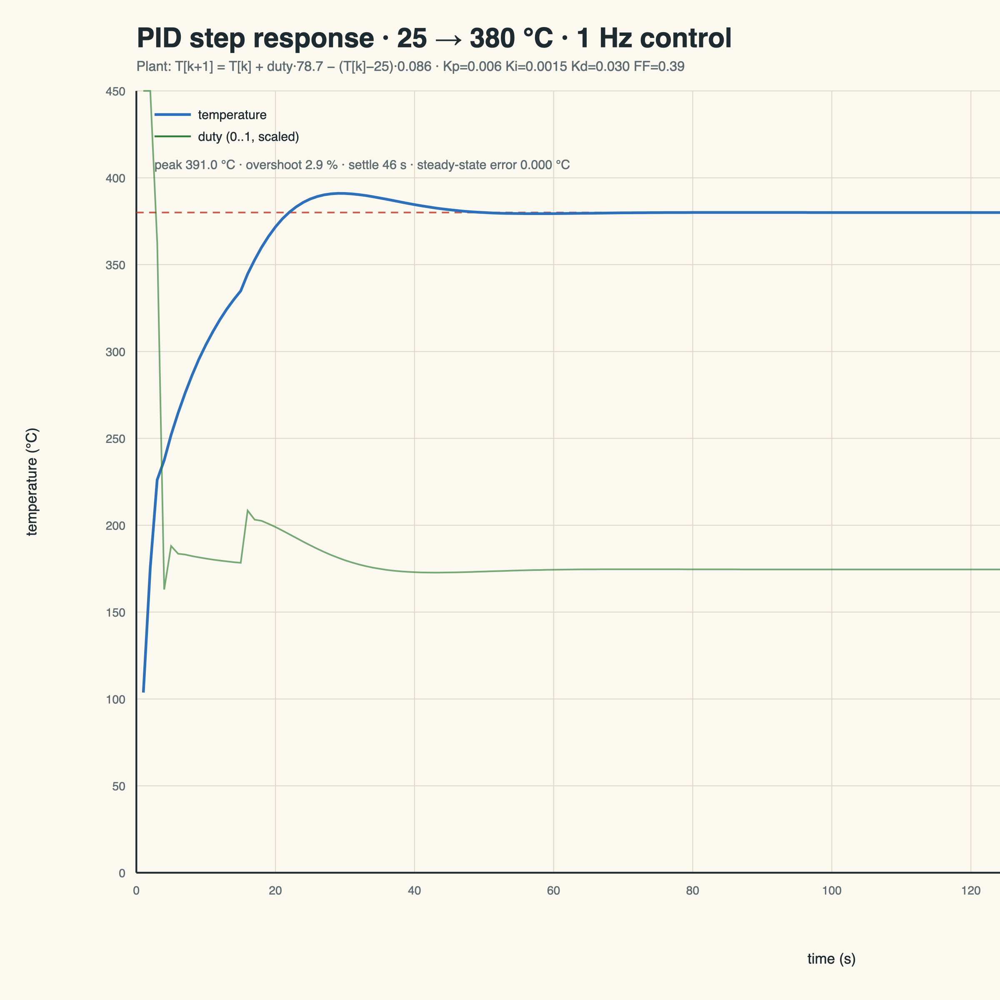

# 测试报告 — C210 焊笔控制器

日期：2026-11-21
工程：`/Users/theo-richard/workspace/projects/stc32/stc8g1k08a-c210`
芯片：STC8G1K08A-8PIN（实测目标，UID `F794C4CA41F89F`）
工具链：SDCC 4.6.0（`-mmcs51`）、stcgal 1.10、KiCad 10.0.8

---

## 1. 构建结果

```text
make clean && make
Stack starts at: 0x76 (sp set to 0x75) with 138 bytes available.
   EXTERNAL RAM     0x0001   0x0049      73     1024
   ROM/EPROM/FLASH  0x0000   0x1acf    6864     8192
```

| 项 | 结果 |
|---|---|
| ROM | **6864 / 8192 B（83.8%，余量 1328 B）** |
| XRAM | **1024 B 配置，已用 73 B** |
| 栈 | **138 B 可用**（SP=0x75） |
| `.bin` | 6864 B |
| `.hex` | 18990 B |
| 编译警告 | 仅 SDCC `--std-c23` 的 `__has_builtin` / `__STDC_HOSTED__` 重定义，无代码告警 |

> 首次链接曾因 IRAM DSEG 不足失败（`Couldn't get 67 bytes allocated in internal RAM`）。把 `g_app_pid` 和 app 状态移到 `__xdata` 后，XRAM 用 73B，栈 138B，链接通过。ROM 未启用定点 Q16，float PID 仍有余量。

---

## 2. 静态自检 `make verify`

**55 项全部通过**。关键项：

```text
ok   0x0000 是 LJMP（实际 0x02），复位目标 0x0082
ok   0x000B 是 Timer0 LJMP（实际 0x02）
ok   Timer0 向量目标 0x015B 在 0x0000..0x1FFF
ok   _timer0_isr @0x015B == Timer0 向量 0x015B
ok   _main/_app_task/_max31855_read/_pid_compute/_heater_task/_led_task/_button_task 全部存在
ok   main.lst 含 P3.0/P3.1/P3.2/P3.3/P5.4/P5.5 初始化痕迹
ok   main.lst 含 P3M0/P3M1/P5M0/P5M1/WDT_CONTR
ok   机器码含 SETB/CLR P5.5（D2 CD/C2 CD）和 SETB/CLR P5.4（D2 CC/C2 CC）
ok   ROM 占用 6864 B，XRAM 1024 B（已用 73 B）
ok   .bin 大小 6864 B == 完整镜像
```

### 2.1 反汇编证据

```text
SETB P5.4 @ 0x1368
CLR  P5.4 @ 0x00F3, 0x0152, 0x132C, 0x1372, 0x1397
SETB P5.5 @ 0x13F1, 0x1471
CLR  P5.5 @ 0x00F5, 0x0154, 0x13B2, 0x13CC, 0x13EE, 0x140F, 0x1474
Timer0 向量 0x000B: 02 01 5B -> _timer0_isr @0x015B
```

> **SDCC 4.6 中断向量坑**：mcs51 后端只在包含 `main()` 的编译单元生成 IVT。ISR 最初放在 `timer.c` 时，0x000B 没有 LJMP，上板会跳飞。已把 `timer0_isr()` 移到 `main.c`，`timer.c` 只保留 `timer_isr_tick()`；`verify.py` 新增 0x000B 向量检查。这是本工程最重要的“上板前必须验证”的点。

---

## 3. 主机 PID 阶跃测试

`make test-pid` 用系统 `cc` 编译真实 `Core/Src/pid.c`，一阶模型：

```text
T[k+1] = T[k] + duty × 78.7 − (T[k] − 25) × 0.086
dt = 1 s，25 → 380°C，200 s
```

**结果：**

```text
首采样 25°C 输出: 1.0000
  ok   first sample output saturated        1.000 (limit 0.990)
  ok   first sample d_filt == 0             0.000 (limit 0.000)

峰值      : 391.00 °C
超调      : 11.00 °C (2.90%)
调节时间  : 46 s（进入并保持 ±1°C）
稳态值    : 380.000 °C
稳态误差  : -0.000 °C
  ok   overshoot < 10%                      11.004 (limit 38.000)
  ok   settling time < 60 s                 46.000 (limit 60.000)
  ok   steady-state error < 1 C             0.000 (limit 1.000)

ALL PID CHECKS PASSED (CSV: build/pid_step.csv)
```



> 模型常数 78.7°C/s、0.086/s 是按“10W、25→300°C 约 3–4s”的参考工程估算；实际 C210 头会不同。`Kp=0.006, Ki=0.0015, Kd=0.030, FF=0.39` 是 1s 周期、归一化输出的整定值；原始规格的 4.0/0.02/20.0 是毫秒量纲，不能直接用在 0..1 输出上。

---

## 4. KiCad 原理图 / 网表 / ERC

原理图：`docs/pcb/kicad/c210.kicad_sch`（KiCad 10，A3，自定义符号）
网表：`docs/pcb/kicad/c210_schematic.net`（`kicad-cli sch export netlist`）
ERC：`docs/pcb/kicad/c210_schematic.erc`

```text
ERC messages: 7
Errors: 0
Warnings: 7
```

7 条 warning 分两类：

- **5 条 `pin_to_pin`**：4053 未用脚/选择脚接 GND（Bidirectional ↔ Power output），有意为之：
- X1/Y1 必须接 GND；
- Z0/Z1/Z 未用，接 GND 防浮空；
- A/B/C 选择脚接 GND（选 X0/Y0/Z0）。

### 4.1 网表关键检查

| 检查 | 结果 |
|---|---|
| U1 MAX31855 T+/T-/SCK/CS/SO/VCC/GND | ✅ 全部在对应网络 |
| U2 4053 A0=HEAT_P、B0=HEAT_N、A→R9→T_P、B→R10→T_N | ✅ |
| U2 INH、VDD=+5V、VEE/VSS=GND、A1/B1/C0/C1/C=GND | ✅ |
| Q1 G/D/S；D2 K=HEAT_P/A=HEAT_N | ✅ |
| D3/D4 BAT54S pin1=GND、pin2=+3V3、pin3=T_P/T_N | ✅ |
| J1 4×VBUS、4×GND+SHIELD | ✅ |
| R1/R2 5.1k CC；R13 10k CS 上拉；R17 10k SO 下拉；C7 0.1µF | ✅ |
| CC2 与 GND 无短路（v2 修正了 v1 的 R1/R2 间距导致的 CC2→GND 短接） | ✅ |
| USB-C D+/D-/SBU、U1 NC、U4 EPAD | ✅ 仅这些为 NC |

> 完整网表见 [PCB_DESIGN.md §4](PCB_DESIGN.md#4-完整网表kicad-c210_schematicnet)。

---

## 5. 烧录记录

命令：

```bash
make flash
# stcgal -p /dev/cu.usbmodemFX2348N1 -P stc8g -l 1200 -b 57600 -t 24000 build/stc8g1k08a-c210.hex
```

实际日志：

```text
Waiting for MCU, please cycle power: done
Target model:
  Name: STC8G1K08A-8PIN
  Magic: F794
  Code flash: 8.0 KB
  EEPROM flash: 4.0 KB
Target frequency: 23.989 MHz
Target BSL version: 7.3.13U
Target wakeup frequency: 35.900 KHz
Target ref. voltage: 1191 mV
Target mfg. date: 2026-03-30
Target options:
  reset_pin_enabled=False
  clock_gain=high
  watchdog_por_enabled=False
  watchdog_stop_idle=True
  watchdog_prescale=256
  low_voltage_reset=True
  low_voltage_threshold=0
  eeprom_erase_enabled=True
  bsl_pindetect_enabled=False
  por_reset_delay=long
  rstout_por_state=high
  uart1_remap=True
  uart2_passthrough=True
  uart2_pin_mode=push-pull
  epwm_open_drain=True
  program_eeprom_split=8192
Loading flash: 6864 bytes (Intel HEX)
Target frequency: Target 24.000 MHz
Adjusted frequency: 24.011 MHz(0.045%)
Switching to 57600 baud: done
Erasing flash: done
Writing flash: 100%
Finishing write: done
Setting options: done
Target UID: F794C4CA41F89F
Disconnected!
```

**结论：烧录成功。** 目标频率 24.011MHz（0.045% 误差），与 `MAIN_Fosc=24000000UL` 一致；`reset_pin_enabled=False` 确认 P5.4 是普通 GPIO。

---

## 6. 裸板自检（待目视确认）

当前裸板没有 MAX31855。按固件逻辑：

| 步骤 | 预期现象 | 说明 |
|---|---|---|
| 上电 | P5.5 **1Hz 慢闪** | R17 把 SO 拉低，MAX31855 读 0°C，BOOT 后进 STANDBY |
| 短按 P3.3 到 GND | 进入 HEATING，P5.5 **2Hz 闪** | PID 满占空比，但无升温 |
| 约 10 个 1s 周期后 | P5.5 **5Hz 快闪**，加热关断 | 连续 10 周期 duty≥790ms 且 T<100°C → FAULT |
| 再长按 3s | 若 T≤350°C 且传感器有效 → 回 STANDBY | 裸板读 0°C，有效；长按可清 |
| 复位/重新上电 | 重复 1Hz 慢闪 | 看门狗/复位后 P5.4 由 R4 1k 拉低，加热关断 |

> 这一步需要你在板前目视确认。烧录本身已成功；如果 LED 不是慢闪，先检查 P5.5 LED 极性、P5.4 是否被 ISP 选项设为复位脚（stcgal 显示 `reset_pin_enabled=False`，正常）。

---

## 7. 待完成 / 下一步

1. **目视确认裸板 LED**：待机慢闪 → 按键 2Hz → 约 10s 5Hz FAULT → 长按回待机。
2. **接 MAX31855 + K 热电偶（不接加热）**：室温/热水/冰水读数；LED 阈值 300/400°C；校准 `C210_TC_GAIN`（300/380°C 两点）。
3. **接 PCB + C210 头，限流 5V/2A**：最大可达温度、2A 电流、PID 阶跃、380°C 稳态波动、F2/D2/R4/BAT54S 实测。
4. **安全测试**：传感器开路/短路、T>400/420、看门狗、断 F2、Q1 关断。
5. **对抗审查回写**：见 [docs/reviews/](docs/reviews/)；有 BLOCKER/MAJOR 时先修再上电。

---

## 8. 测试环境

| 项 | 值 |
|---|---|
| macOS | darwin 25.3.0 arm64 |
| SDCC | 4.6.0，`/Users/theo-richard/workspace/toolchains/sdcc-c251/bin/` |
| stcgal | 1.10，`/Users/theo-richard/workspace/toolchains/stcgal/bin/stcgal` |
| KiCad | 10.0.8，`/Applications/KiCad/KiCad.app/Contents/MacOS/kicad-cli` |
| 串口 | `/dev/cu.usbmodemFX2348N1` |
| 烧录参数 | `-P stc8g -l 1200 -b 57600 -t 24000` |
| 目标 | STC8G1K08A-8PIN，UID `F794C4CA41F89F` |
